# CampusBite — Software Design Document

## 1. Problem Statement

In academic institutions, campus canteens experience intense bursts of demand during short intervals between lectures, lunch breaks, and evening hours. Traditional canteen operations rely on physical walk-in queues, manual paper ordering, verbal communication at preparation counters, and cash or ad-hoc UPI payments. This setup causes significant operational bottlenecks: students face prolonged wait times and crowd congestion, while canteen personnel struggle with order misplacement, lack of real-time inventory visibility, and manual reconciliation between receipts and kitchen preparation queues.

**CampusBite** is a campus canteen ordering system built to streamline pre-ordering, kitchen queue coordination, and digital transactions. It serves two distinct user roles:

1. **Students:** Need to browse active food and beverage offerings, assemble orders via an interactive shopping cart, checkout with server-verified prices, execute payments through an automated workflow, receive verified order confirmations, track order history, and self-manage account credentials.
2. **Canteen Administrators:** Need a dedicated portal to manage menu inventory (adding, updating prices, modifying availability flags, or deleting items) and monitor a priority-sorted kitchen fulfillment queue to transition orders through defined preparation stages.

### Scope and Limitations of the Implementation
The current implementation is an academic monolithic application designed for a single campus canteen. The system implements a simulated payment processing workflow rather than integrating a live commercial payment gateway. Menu availability is tracked via a binary active/inactive flag rather than real-time numerical stock decrementing. Client-side carts are stored in browser local storage, and administrator authentication uses an in-memory session registry rather than persistent clustered storage.

---

## 2. Layered Architecture

CampusBite follows a multi-tier layered architecture combining server-rendered web views (Thymeleaf) and stateless JSON REST endpoints on top of a Spring Boot core. The system deliberately uses Spring's `JdbcTemplate` for direct SQL data access rather than an object-relational mapping (ORM) framework like Hibernate or JPA.

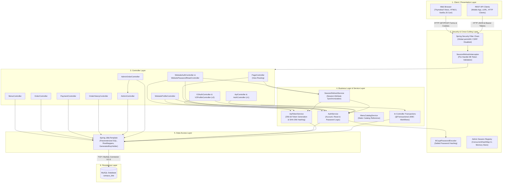

### Architectural Component Descriptions

1. **Client / Presentation Layer:**
   - **Thymeleaf Templates:** Server-side rendered HTML views (`index.html`, `menu.html`, `cart.html`, `checkout-bill.html`, `payment-bill.html`, `order-confirmation.html`, `orders.html`, `profile.html`, `admin.html`, `admin-orders.html`).
   - **Client-Side JavaScript (`canteen.js`):** Manages shopping cart operations in browser `localStorage`, calculates item subtotals, and dynamically submits form structures to backend controllers.
   - **REST Consumers:** Mobile or third-party HTTP clients communicating via JSON payloads and Bearer headers.

2. **Security & Cross-Cutting Components:**
   - **Spring Security (`SecurityConfig`):** Configured to allow all requests (`permitAll()`) and disable default CSRF/form-login filters, delegating authentication to application-level handlers.
   - **`SessionRefreshInterceptor`:** Registered via `WebMvcConfigurer` on paths `/`, `/menu`, `/cart`, and `/profile`. Intercepts incoming requests, retrieves the session's `apiToken`, and queries the database to synchronize session attributes or invalidate revoked sessions.
   - **Cryptographic Security (`BCryptPasswordEncoder` & `ApiTokenService`):** Uses BCrypt with adaptive salting for passwords and `SecureRandom` 256-bit generation with SHA-256 digests for API bearer tokens.
   - **Admin Isolation Registry (`AdminController`):** Maintains administrator sessions in an in-memory `ConcurrentHashMap<String, AdminSession>` using custom `ADMINSESSIONID` cookies, completely isolated from standard student servlet sessions.

3. **Controller Layer:**
   Spring MVC `@Controller` and `@RestController` classes map endpoints, extract parameters, perform input validation, and assemble view models or JSON responses. Notably, several controllers (such as `OrderController`, `PaymentController`, `MenuController`, and `AdminOrderController`) coordinate data operations directly using `JdbcTemplate` rather than routing through an intermediary service interface.

4. **Business Logic & Service Layer:**
   - `AuthService`: Encapsulates user registration, password credential verification, timing-safe password reset generation, token consumption with row locking, and profile updates.
   - `ApiTokenService`: Manages creation, verification, SHA-256 hashing, and revocation of 5-day Bearer tokens.
   - `SessionRefreshService`: Bridges servlet `HttpSession` attributes with database user state.
   - `MenuCatalogService`: Provides a static in-memory fallback catalog of standard cafeteria offerings.
   - In-Controller Business Logic: Order creation, price calculation, and payment progression logic reside directly in transactional controller methods.

5. **Data Access Layer:**
   All persistence is handled using Spring's core `JdbcTemplate`. Queries are expressed as parameterized raw SQL statements to prevent SQL injection. Auto-generated primary keys are retrieved via `GeneratedKeyHolder`. The application does not use JPA entities, Hibernate sessions, or Spring Data repositories.

6. **Persistence Layer:**
   A relational MySQL 8.0+ database (`campus_bite`) enforcing relational integrity through foreign keys, check constraints, unique indexes, and InnoDB transaction isolation.

---

## 3. Data Model: ER Diagram and Entity Descriptions

The application data model consists of seven relational tables in MySQL.

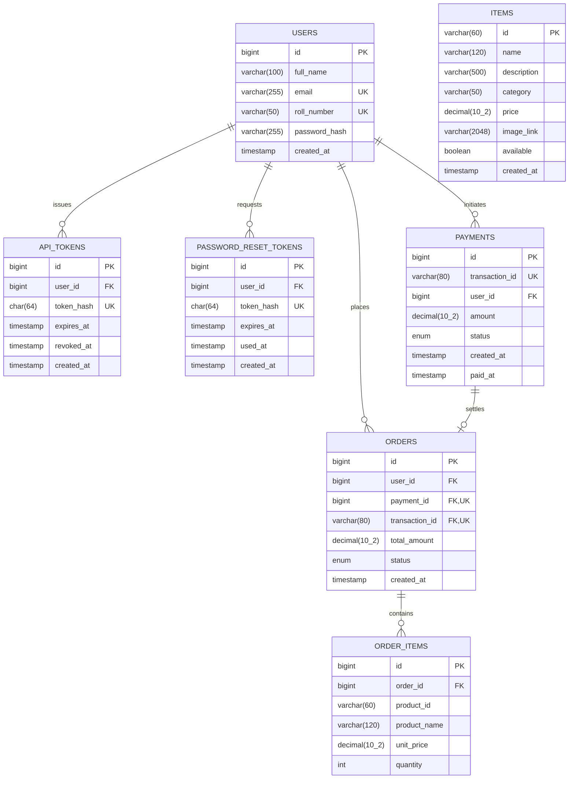

### Entity Description Table

| Entity / Table | Purpose | Primary Key | Important Relationships |
| :--- | :--- | :--- | :--- |
| **`users`** | Stores registered student accounts, credentials, and academic roll numbers. | `id` (BIGINT Auto-Increment) | One-to-Many with `api_tokens`, `password_reset_tokens`, `orders`, and `payments`. `email` and `roll_number` are unique. |
| **`api_tokens`** | Stores SHA-256 digests of active and revoked 5-day Bearer tokens. | `id` (BIGINT Auto-Increment) | Many-to-One with `users` via `user_id` (`ON DELETE CASCADE`). Plaintext tokens are not stored. |
| **`password_reset_tokens`** | Stores single-use SHA-256 digests of 30-minute password recovery tokens. | `id` (BIGINT Auto-Increment) | Many-to-One with `users` via `user_id` (`ON DELETE CASCADE`). Tracks consumption via `used_at`. |
| **`items`** | Stores cafeteria food and beverage catalog offerings and retail prices. | `id` (VARCHAR(60) Slug) | Natural primary key (e.g. `masala-dosa`). Flagged active/inactive via `available`. Price constrained (`CHECK price >= 0`). |
| **`orders`** | Master pre-order record tracking fulfillment state and billing total. | `id` (BIGINT Auto-Increment) | Many-to-One with `users` via `user_id`. One-to-One (0..1) with `payments` via `payment_id` and `transaction_id`. Status is an enum (`PLACED`, `PREPARING`, `READY`, `COMPLETED`, `CANCELLED`). |
| **`order_items`** | Immutable financial line item snapshots captured at the moment of order placement. | `id` (BIGINT Auto-Increment) | Many-to-One with `orders` via `order_id` (`ON DELETE CASCADE`). Captures `product_name` and `unit_price` at checkout. |
| **`payments`** | Records financial transactions, payment statuses, and verification timestamps. | `id` (BIGINT Auto-Increment) | Many-to-One with `users` via `user_id`. Referenced by `orders.payment_id` and `orders.transaction_id`. Status is an enum (`PENDING`, `PAID`, `FAILED`). |

### Key Structural & Relational Characteristics
1. **Financial Snapshot Pattern:** `order_items` stores historical copies of `product_name` and `unit_price` alongside `product_id`. It does not define an active foreign key constraint to `items(id)`. This prevents administrative price updates or product deletions in `items` from retroactively altering historic customer bills or causing cascade deletion failures.
2. **Nullable Order-to-Payment Association:** When an order is initially created via `/order/checkout`, its `payment_id` and `transaction_id` columns in `orders` are `NULL`, with status set to `PLACED`. The payment record is established only when the student proceeds to `/payment/bill`.
3. **Defense-in-Depth Token Persistence:** Neither `api_tokens` nor `password_reset_tokens` persist raw client tokens. Only their 64-character hexadecimal SHA-256 digests are stored, preventing credential replay if database tables are exposed.

---

## 4. UML Sequence Diagrams for All Implemented Flows

The following diagrams illustrate the dynamic execution of all implemented end-to-end flows.

### 4.1 Student Registration

Handles new student account creation, validates input fields, verifies password confirmation, enforces uniqueness rules, and saves the BCrypt password hash.

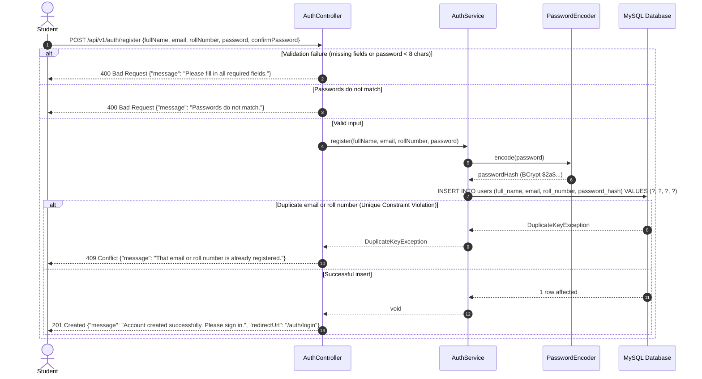

---

### 4.2 Student Login and Authentication

CampusBite supports two distinct login paths: stateful web session login and stateless API v2 Bearer token login.

#### 4.2.1 Web Session Login (`POST /auth/login`)
Authenticates credentials, mitigates session fixation, generates an API token in the database, and stores session attributes.

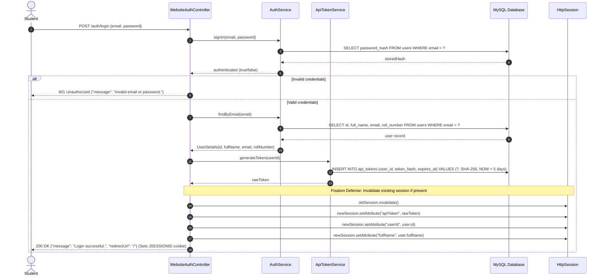

#### 4.2.2 API v2 Stateless Bearer Login (`POST /api/v2/auth/login`)
Designed for mobile and API clients. Returns an opaque token in the JSON response without creating a servlet session.

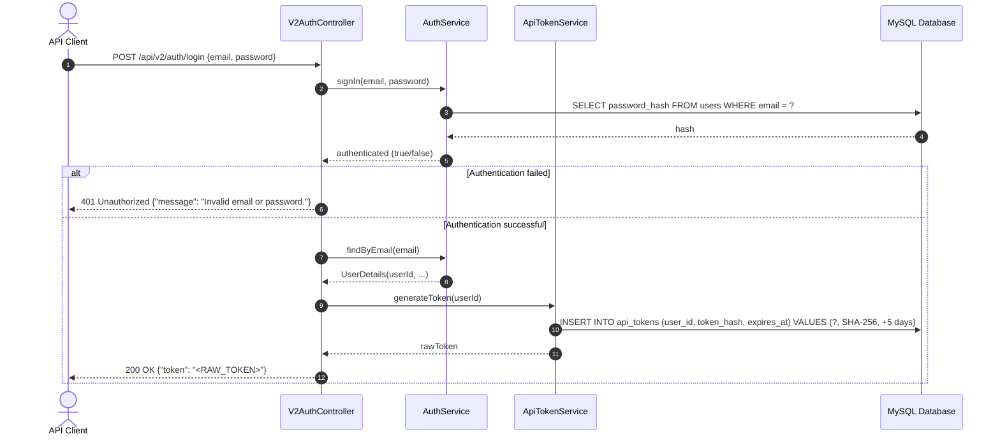

---

### 4.3 Menu Browsing and Cart Management

Shows how active menu items are rendered from MySQL and how the shopping cart operates on the client side using `localStorage` without generating server load.

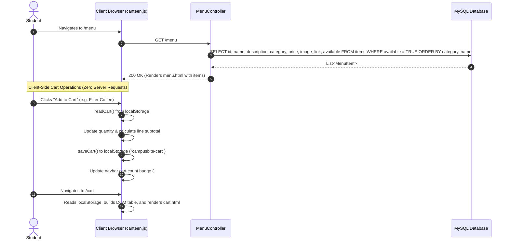

---

### 4.4 Checkout and Order Creation

Traces cart submission, server-side price lookup, item deduplication, and atomic insertion into `orders` and `order_items`.

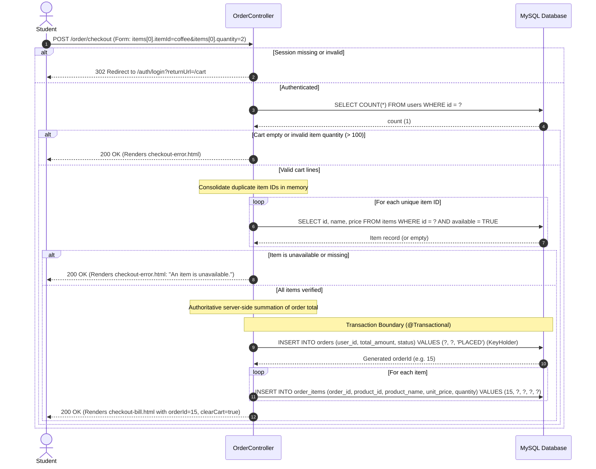

---

### 4.5 Payment Processing and Order Confirmation

Details the multi-step simulated payment sequence: bill generation with pessimistic locking, simulated gateway payment, and final receipt rendering.

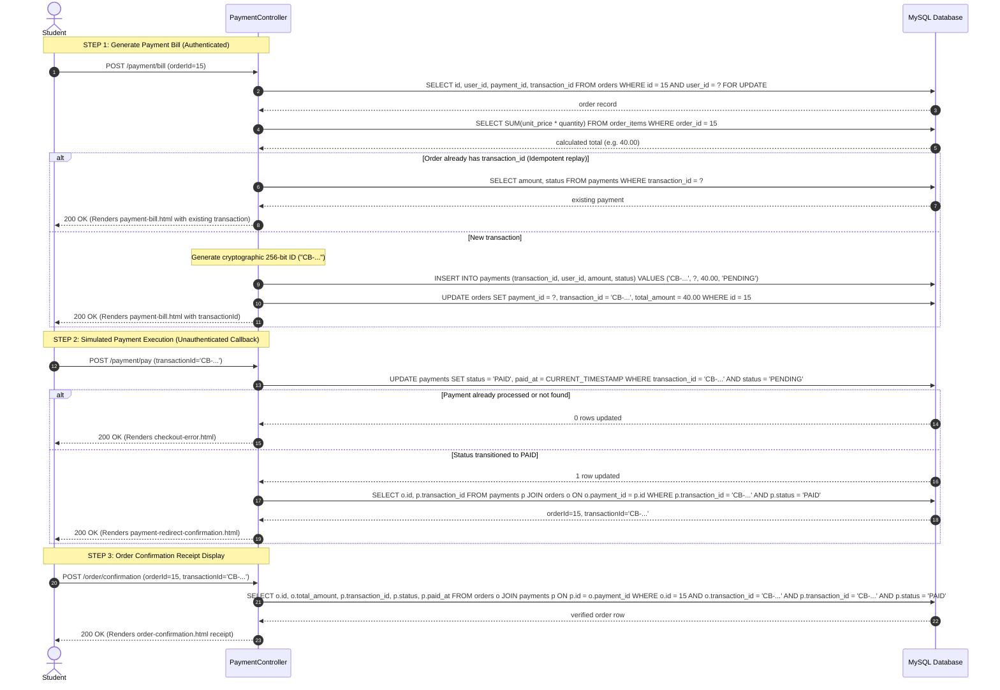

---

### 4.6 Student Order History

Shows an authenticated student retrieving past orders, linking payment status, and populating line item snapshots.

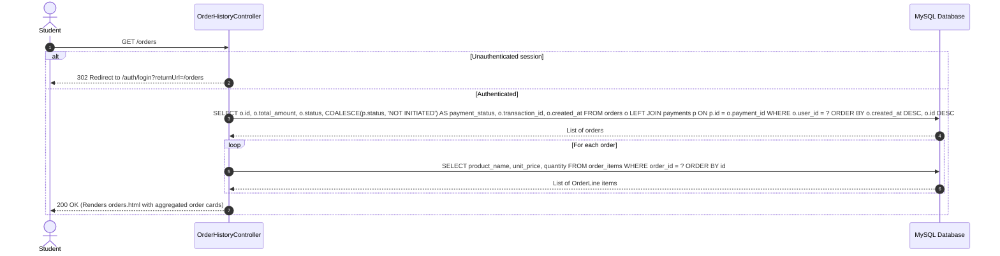

---

### 4.7 Profile Management

Traces profile inspection, name/roll number updates, and password changes with session token re-issuance.

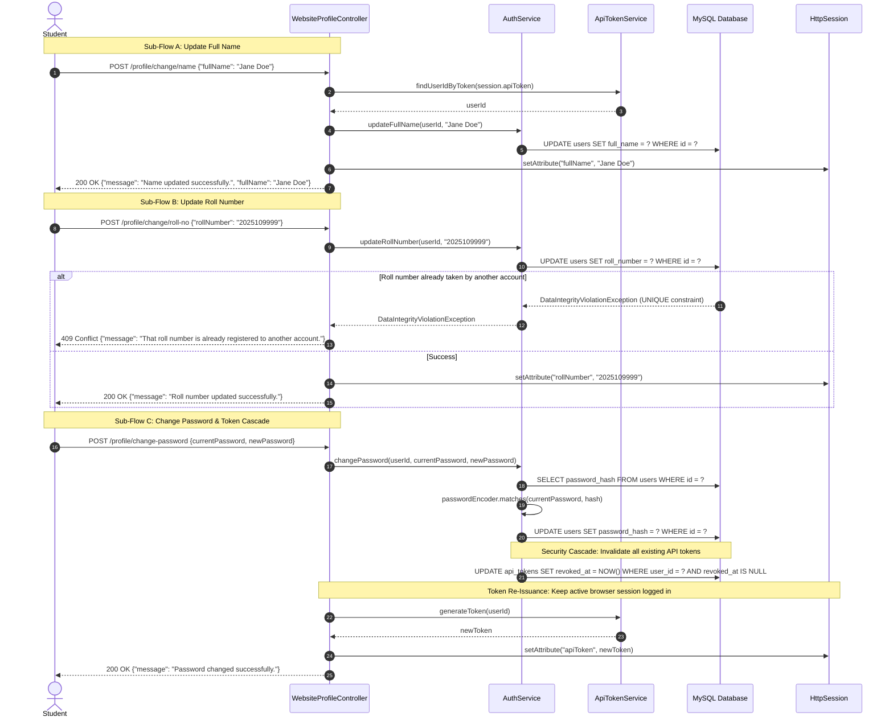

---

### 4.8 Password Recovery

Illustrates the self-service password recovery flow: anti-enumeration reset request, SMTP dispatch, token validation, and password reset with token revocation.

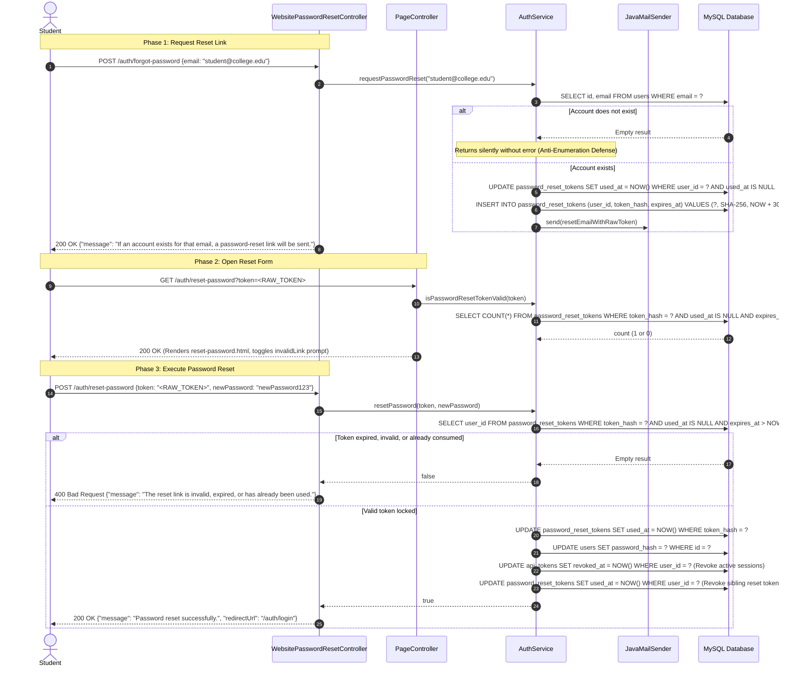

---

### 4.9 Administrator Authentication and Menu Management

Details administrator login using constant-time credential comparison, in-memory session mapping, cookie issuance, and menu CRUD operations.

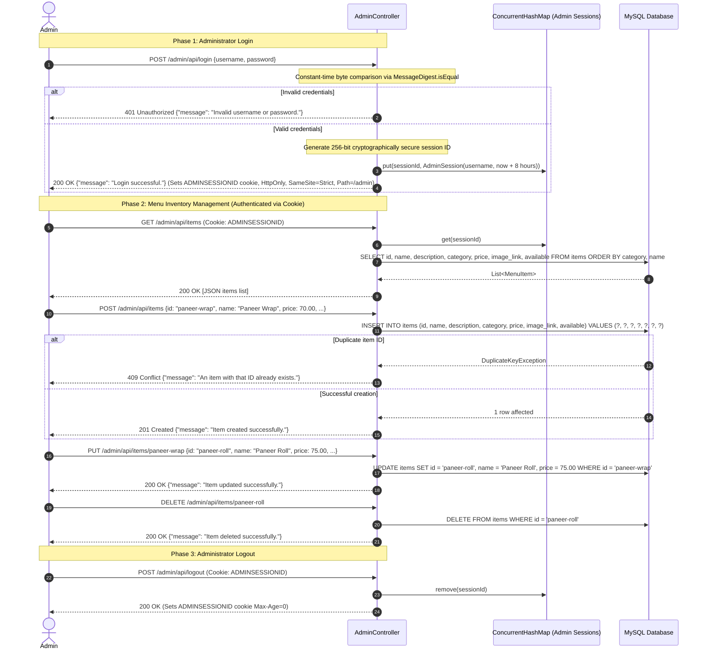

---

### 4.10 Administrator Order Management

Illustrates how canteen kitchen staff inspect paid orders and advance orders through the preparation state machine.

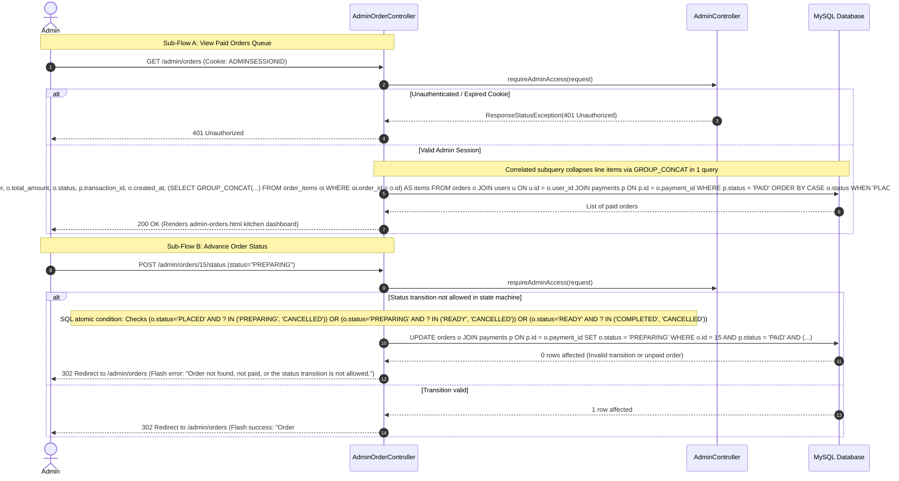

---

## 5. Design Summary and Limitations

### Design Summary
CampusBite implements a pragmatic, clean monolithic design that couples Spring Boot 3.5.0, Thymeleaf, and MySQL 8.0:
- **Direct JDBC Persistence:** Persists data using Spring's `JdbcTemplate` with raw SQL queries and transactional boundaries (`@Transactional`), deliberately avoiding ORM configuration, lazy-loading pitfalls, and Hibernate cache overhead.
- **Architectural Coupling:** Controller classes actively manage business transactions and data querying directly for orders, payments, and admin queues. Dedicated services (`AuthService`, `ApiTokenService`, `SessionRefreshService`) encapsulate cross-cutting identity and security logic.
- **Multi-Tier Identity Architecture:** Distinct client channels are segregated at the architectural level: student web sessions rely on standard servlet sessions validated against database tokens; mobile clients use stateless Bearer tokens with SHA-256 database storage; and administrators use an independent cookie linked to an in-memory session registry.
- **Transactional & Concurrency Guarantees:** Concurrency race conditions are actively managed at critical points using pessimistic row locking (`SELECT ... FOR UPDATE`) during payment bill generation and password reset redemption.

### Implementation Limitations
Based on an analysis of the codebase, the following limitations are present in the actual implementation:

1. **Simulated Payment Processing:** The payment workflow simulates external gateway processing via internal status updates (`PENDING` to `PAID`). There is no integration with an external payment gateway API, payment webhook signature validation, or real merchant settlement.
2. **In-Memory Administrator Session Store:** Administrator sessions reside in a `ConcurrentHashMap` inside `AdminController`. Sessions do not survive server restarts, cannot be shared across multiple application instances, and require manual opportunistic garbage collection.
3. **Static Administrator Credentials:** Admin credentials (`app.admin.username` and `app.admin.password`) are defined as static environment variables/properties rather than as database-backed records with independent password hashing.
4. **Client-Side Shopping Cart Persistence:** Shopping cart items are stored entirely within browser `localStorage`. If a student switches devices or browsers before checkout, cart contents do not persist.
5. **Binary Inventory Availability:** The `items` table tracks stock solely through a boolean flag (`available = TRUE/FALSE`). The system lacks inventory quantity tracking, stock decrementing, or automated out-of-stock triggers when high demand occurs.
6. **Single-Canteen Tenant Architecture:** The schema and controllers are architected for a single campus canteen; there is no multi-vendor or multi-canteen partitioning in the database schema.
