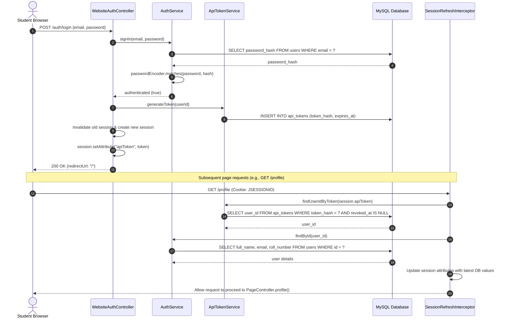
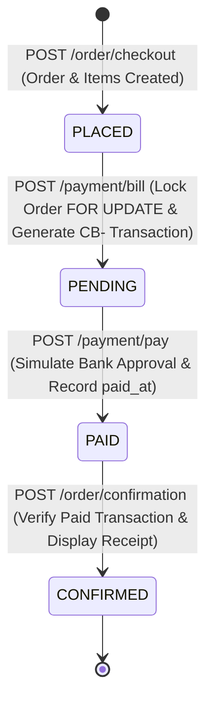
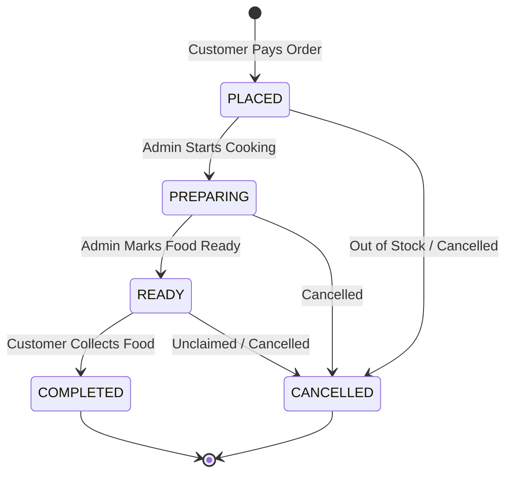
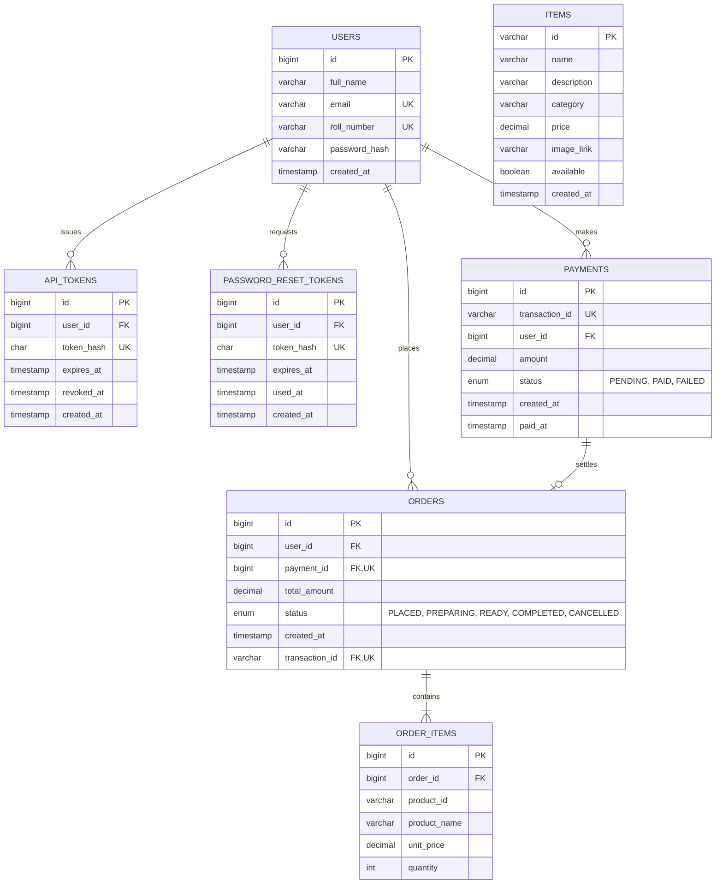

# CampusBite — Campus Canteen Ordering System

[](https://openjdk.org/projects/jdk/21/)
[](https://spring.io/projects/spring-boot)
[](https://spring.io/projects/spring-security)
[](https://www.mysql.com/)
[](https://www.thymeleaf.org/)
[](https://getbootstrap.com/)
[](https://maven.apache.org/)

**CampusBite** is a campus canteen pre-ordering and management platform designed to eliminate long lunchtime queues, streamline canteen kitchen operations, and provide university students with a self-service meal reservation experience.

Built with **Java 21**, **Spring Boot 4.1.1**, **Spring JDBC (`JdbcTemplate`)**, and **MySQL 8.0+**, CampusBite features a responsive **Thymeleaf + Bootstrap 5.3.3** web frontend, dual-channel user authentication (web session and token-based REST APIs), an authoritative checkout and payment simulation pipeline, and a dedicated, session-isolated administrator control panel for real-time menu management and order progression.

---

## Table of Contents

- [Project Overview](#project-overview)
- [Key Features](#key-features)
- [Application Screenshots](#application-screenshots)
  - [Student Discovery & Menu Experience](#1-student-discovery--menu-experience)
  - [Student Authentication & Profile Management](#2-student-authentication--profile-management)
  - [Cart, Checkout & Order Placement](#3-cart-checkout--order-placement)
  - [Simulated Payment Gateway & Receipts](#4-simulated-payment-gateway--receipts)
  - [Administrator Control Panel](#5-administrator-control-panel)
- [Technology Stack](#technology-stack)
- [System Architecture](#system-architecture)
- [Project Directory Structure](#project-directory-structure)
- [User Roles & Access Control](#user-roles--access-control)
- [Core Application Workflows](#core-application-workflows)
  - [1. User Authentication & Session Synchronization](#1-user-authentication--session-synchronization)
  - [2. Cart Management & Authoritative Checkout](#2-cart-management--authoritative-checkout)
  - [3. Payment Gateway Simulation](#3-payment-gateway-simulation)
  - [4. Administrator Order Processing](#4-administrator-order-processing)
  - [5. Self-Service Password Recovery](#5-self-service-password-recovery)
- [Database Design & Schema](#database-design--schema)
  - [Entity-Relationship Model](#entity-relationship-model)
  - [Database Tables & Relationships](#database-tables--relationships)
  - [Database Setup Script](#database-setup-script)
- [Configuration & Environment Variables](#configuration--environment-variables)
- [Prerequisites](#prerequisites)
- [Installation & Setup Guide](#installation--setup-guide)
  - [Step 1: Clone the Repository](#step-1-clone-the-repository)
  - [Step 2: Database Initialization](#step-2-database-initialization)
  - [Step 3: Environment Configuration](#step-3-environment-configuration)
  - [Step 4: Build the Application](#step-4-build-the-application)
  - [Step 5: Run the Application](#step-5-run-the-application)
- [Application Endpoints & Routes](#application-endpoints--routes)
  - [Web Views (HTML Pages)](#web-views-html-pages)
  - [Website Actions & Form Handlers](#website-actions--form-handlers)
  - [API v1 (REST Endpoints)](#api-v1-rest-endpoints)
  - [API v2 (Stateless Bearer Token Endpoints)](#api-v2-stateless-bearer-token-endpoints)
  - [Admin REST Endpoints](#admin-rest-endpoints)
- [Testing & Quality Assurance](#testing--quality-assurance)
- [Security Considerations & Implementation Details](#security-considerations--implementation-details)
- [Known Limitations & Proposed Enhancements](#known-limitations--proposed-enhancements)
- [Academic Rubric Alignment](#academic-rubric-alignment)
- [License](#license)

---

## Project Overview

Campus dining halls and canteens face severe rush-hour congestion between academic lectures, leading to lost time, unpredictable meal delays, and manual order reconciliation errors.

**CampusBite** addresses these pain points by providing:

1. **Zero-Queue Pre-Ordering**: Students browse available canteen dishes, assemble an order in a persistent shopping cart, and review itemized pricing before placing orders online.
2. **Server-Side Authoritative Pricing**: Item prices, active availability, and total order calculations are validated directly against the MySQL database, preventing client-side cart tampering.
3. **Simulated Frictionless Payment**: A transaction-safe checkout and payment gateway simulation issues unique tracking IDs (`CB-...`) and automatically updates order state upon payment confirmation.
4. **Kitchen Operations Visibility**: Canteen kitchen operators manage the active menu catalog and advance placed orders through an enforced operational lifecycle (`PLACED` &rarr; `PREPARING` &rarr; `READY` &rarr; `COMPLETED`).
5. **Architectural Cleanliness**: Built using idiomatic Spring Boot patterns, strict data access separation via `JdbcTemplate`, BCrypt password hashing, SHA-256 token hashing, and session fixation protection.

---

## Key Features

### Student Experience
- **Interactive Menu Catalog**: Real-time keyword filtering, category classification (*Meals*, *Quick bites*, *Drinks*, *Sweet treats*), price indicators, and visual dish previews.
- **Client-Side Cart with Local Storage**: Resilient client-side state in `localStorage` supporting item addition, dynamic quantity modifications, item removal, and live badge count updates.
- **Authoritative Checkout**: Rigorous server-side verification ensuring that every submitted cart item exists, is marked `available = TRUE`, and is charged at the database price.
- **Simulated Payment Gateway**: Two-phase payment authorization generating persistent transaction records, preventing duplicate charges, and providing an instant printable order receipt.
- **Personalized Order History**: Comprehensive overview of past purchases showing timestamped order cards, itemized breakdowns, unit prices, total amounts, and payment verification tags.
- **Profile & Credential Management**: Inline updating of full name and college roll number (with database unique constraint verification), in-app password changes, and SMTP-driven password resets.

### Canteen Administration
- **Isolated Admin Authentication**: Dedicated administrator sign-in portal completely decoupled from the student authentication domain, utilizing secure, HttpOnly, SameSite-restricted cookies (`ADMINSESSIONID`) and constant-time string comparisons.
- **Menu Catalog Management**: Full CRUD capabilities for menu items (ID, name, description, category, unit price, image URL, and availability toggle).
- **Order Queue Tracking**: Live dashboard showing all confirmed `PAID` orders sorted chronologically and prioritized by active preparation status.
- **Enforced Order Lifecycle**: State machine preventing invalid order updates, ensuring kitchen staff progress orders strictly from `PLACED` to `PREPARING`, `READY`, and `COMPLETED` (or `CANCELLED`).

### Engineering & Security
- **Data Access via `JdbcTemplate`**: Clear, explicit SQL queries and transactions using Spring JDBC with zero ORM overhead or hidden N+1 query surprises.
- **Cryptographic Security**: Strong BCrypt password hashing with unique salts for user credentials and SHA-256 cryptographic hashing for stored API and password-reset tokens.
- **Session Refresh Interceptor**: Spring MVC `HandlerInterceptor` that continuously validates API tokens and reloads profile attributes into the active HTTP session.
- **Dual API Channels**: Legacy cookie-session REST API (`/api/v1/auth`) and modern stateless Bearer-token REST API (`/api/v2/auth` and `/api/v2/profile`).

---

## Application Screenshots

Every view in CampusBite is designed with a modern, responsive layout inspired by campus dining aesthetics. Below is a complete visual walkthrough of the platform.

### 1. Student Discovery & Menu Experience

| Index / Landing Page | Campus Menu Catalog |
| :---: | :---: |
|  |  |
| *Landing page featuring value propositions, quick links, and responsive navigation.* | *Live searchable menu with category pills, pricing in INR (₹), and quick-add actions.* |

---

### 2. Student Authentication & Profile Management

| Student Registration | Student Sign-In |
| :---: | :---: |
|  |  |
| *Registration form capturing full name, university email, roll number, and password.* | *Sign-in screen featuring secure authentication, remember me, and password reset links.* |

| Student Profile & Settings |
| :---: |
|  |
| *Self-service profile page allowing inline updates of student details and secure password change.* |

---

### 3. Cart, Checkout & Order Placement

| Empty Shopping Cart | Cart with Selected Items |
| :---: | :---: |
|  |  |
| *Zero-state shopping cart with call-to-action to explore the menu.* | *Active cart displaying item thumbnails, quantity adjustment controls, and checkout CTA.* |

| Order Review & Checkout Bill |
| :---: |
|  |
| *Server-generated checkout bill showing order ID, itemized quantities, verified prices, and total.* |

---

### 4. Simulated Payment Gateway & Receipts

| Payment Gateway Simulation | Payment Confirmation & Receipt |
| :---: | :---: |
|  |  |
| *Simulated payment gateway displaying order total and auto-generated transaction ID.* | *Success screen confirming PAID status and referencing the unique transaction ID.* |

| Student Order History ("My Orders") |
| :---: |
|  |
| *Order history view listing past transactions, order status badges (PLACED, PAID), and timestamps.* |

---

### 5. Administrator Control Panel

| Administrator Portal Sign-In | Menu Inventory Management |
| :---: | :---: |
|  |  |
| *Independent administrator sign-in screen isolated from the student authentication pool.* | *Menu management dashboard with inventory count metrics, search filters, and item CRUD modal.* |

| Admin Order Processing & Status Tracking |
| :---: |
|  |
| *Order processing interface displaying paid customer orders, roll numbers, and status transition controls.* |

---

## Technology Stack

| Layer | Technology | Version | Purpose & Architectural Justification |
| :--- | :--- | :--- | :--- |
| **Language** | Java (OpenJDK) | 21 (LTS) | Modern Java features: pattern matching, records for DTOs, text blocks for SQL queries, and strict typing. |
| **Framework** | Spring Boot | 4.1.1 | Application bootstrap, auto-configuration, inversion of control, and lifecycle management. |
| **Web MVC** | Spring MVC | 4.1.1 | DispatcherServlet architecture, model-view-controller binding, and REST controllers. |
| **Security** | Spring Security & Crypto | 6.x | BCrypt password hashing, session configuration, and custom authentication interceptors. |
| **Data Access** | Spring JDBC (`JdbcTemplate`) | 4.1.1 | High-performance, explicit, injection-safe SQL query execution with transaction management. |
| **Database** | MySQL | 8.0+ | Relational schema with foreign keys, cascading deletes, unique indices, and check constraints. |
| **Connection Pool** | HikariCP | Default | Production-ready, lightweight, high-performance JDBC connection pooling. |
| **Email Service** | Spring Boot Starter Mail | 4.1.1 | JavaMailSender integration with SMTP (e.g., Gmail) for sending HTML/plain password reset links. |
| **View Engine** | Thymeleaf | 3.x | Server-side templating engine cleanly rendering HTML5 with natural templates. |
| **UI Framework** | Bootstrap | 5.3.3 | Mobile-first CSS styling, responsive grid system, forms, tables, and modal components. |
| **Client Scripting**| Vanilla JavaScript | ES6+ | Lightweight DOM manipulation, `localStorage` cart state management, and asynchronous fetch requests. |
| **Build Tool** | Apache Maven | 3.x (with `mvnw`) | Dependency management, compilation, resource filtering, and packaging. |

> [!NOTE]
> **Data Access Layer Note:** While `spring-boot-starter-data-jpa` is present in `pom.xml`, the actual application implementation relies exclusively on **Spring JDBC (`JdbcTemplate`)** for all persistence operations. There are no JPA `@Entity` classes or `JpaRepository` interfaces in the codebase.

---

## System Architecture

CampusBite follows a clean, modular **Layered Architecture** adhering to separation of concerns:

```mermaid
flowchart TD
    subgraph Client["Client Tier (Browser)"]
        UI_Web["Thymeleaf Views + HTML5 / CSS3 / Bootstrap"]
        UI_JS["Vanilla JS Cart Manager (localStorage)"]
    end

    subgraph Controllers["Presentation Tier (Spring Boot Controllers)"]
        PC["PageController (View Routing)"]
        MC["MenuController (/menu)"]
        OC["OrderController (/order/checkout)"]
        PayC["PaymentController (/payment/*)"]
        OHC["OrderHistoryController (/orders)"]
        WAC["WebsiteAuthController & ProfileController"]
        AC["AdminController & AdminOrderController (/admin/*)"]
        API1["AuthController & ApiController (/api/v1/*)"]
        API2["V2AuthController & V2ProfileController (/api/v2/*)"]
    end

    subgraph Interceptors["Interceptors & Security"]
        SRI["SessionRefreshInterceptor (Re-verifies token on each request)"]
        SecFilter["Spring Security Filter Chain (PermitAll + Custom Sessions)"]
    end

    subgraph Services["Service Tier (Business Logic)"]
        AS["AuthService (Registration, Password Reset, Profile)"]
        ATS["ApiTokenService (Token Hashing, Expiry & Revocation)"]
        SRS["SessionRefreshService (State Sync)"]
        MS["JavaMailSender (SMTP Email Delivery)"]
    end

    subgraph DataAccess["Data Access Tier"]
        JT["Spring JdbcTemplate"]
        CP["HikariCP Connection Pool"]
    end

    subgraph Database["Persistence Tier (MySQL 8.0+)"]
        DB[("campus_bite Database")]
        T_Users["users"]
        T_Tokens["api_tokens / password_reset_tokens"]
        T_Items["items"]
        T_Orders["orders / order_items"]
        T_Payments["payments"]
    end

    Client --> Interceptors
    Interceptors --> Controllers
    Controllers --> Services
    Services --> JT
    Controllers --> JT
    JT --> CP
    CP --> Database
```



---

## Project Directory Structure

The repository is organized cleanly with separate directories for database migration scripts, preview screenshots, and the primary Spring Boot application:

```text
canteen-repository-root/
│
├── database/                                # Database initialization and schema assets
│   └── campusbite.sql                       # Complete MySQL schema and setup script
│
├── screenshots/                             # Visual previews and UI walkthrough captures
│   ├── Index Page.png                       # Landing page preview
│   ├── Menu.png                             # Menu catalog preview
│   ├── Empty Cart.png                       # Empty shopping cart state
│   ├── Cart With Items.png                  # Active shopping cart with controls
│   ├── Checkout Page.png                    # Order review and checkout bill
│   ├── Payment Page.png                     # Simulated payment gateway
│   ├── Payment Confirmation Page.png        # Payment success confirmation receipt
│   ├── Orders Page.png                      # Student order history
│   ├── Register Page.png                    # Student registration interface
│   ├── Signin Page.png                      # Student login interface
│   ├── Profile Page.png                     # Student profile management
│   ├── Admin - Signin.png                   # Dedicated admin portal login
│   ├── Admin - Managing Items.png           # Admin menu catalog CRUD dashboard
│   └── Admin - Managing Orders.png          # Admin order tracking and status updates
│
├── canteen/                                 # Spring Boot application root directory
│   ├── pom.xml                              # Maven project definition and dependencies
│   ├── mvnw / mvnw.cmd                      # Cross-platform Maven wrapper scripts
│   ├── HELP.md                              # Spring Boot starter reference links
│   └── src/
│       ├── test/java/com/campus/canteen/
│       │   └── CanteenApplicationTests.java # Spring Boot application context test
│       │
│       └── main/
│           ├── resources/
│           │   ├── application.properties   # Datasource, mail, and admin configuration
│           │   ├── static/
│           │   │   ├── css/canteen.css      # Core application stylesheet
│           │   │   ├── js/canteen.js        # Cart manager, search filters, and toasts
│           │   │   └── images/              # Static image assets
│           │   └── templates/               # Thymeleaf server-rendered HTML templates
│           │       ├── index.html           # Landing page
│           │       ├── menu.html            # Menu catalog
│           │       ├── cart.html            # Shopping cart
│           │       ├── checkout-bill.html   # Order checkout bill
│           │       ├── payment-bill.html    # Payment initiation
│           │       ├── payment-redirect-confirmation.html # Payment submission bridge
│           │       ├── order-confirmation.html # Order receipt confirmation
│           │       ├── orders.html          # Order history
│           │       ├── login.html           # Student login
│           │       ├── register.html        # Student registration
│           │       ├── profile.html         # Student profile settings
│           │       ├── forgot-password.html # Password reset request
│           │       ├── reset-password.html  # Password reset submission
│           │       ├── admin.html           # Admin dashboard & menu management
│           │       ├── admin-orders.html    # Admin order management
│           │       ├── checkout-error.html  # Checkout error screen
│           │       └── error/               # Custom HTTP error templates
│           │           ├── 403.html         # 403 Access Forbidden page
│           │           └── 404.html         # 404 Not Found page
│           │
│           └── java/com/campus/canteen/
│               ├── CanteenApplication.java  # Spring Boot main entrypoint
│               ├── SecurityConfig.java      # Spring Security filter chain configuration
│               ├── PageController.java      # Web page view router
│               ├── ApiController.java       # Health / version API
│               ├── config/
│               │   ├── WebMvcConfig.java    # Interceptor registry configuration
│               │   ├── PasswordConfig.java  # BCryptPasswordEncoder bean definition
│               │   └── SessionRefreshInterceptor.java # Session re-validation interceptor
│               ├── model/
│               │   └── CheckoutForm.java    # Checkout form data binding model
│               ├── service/
│               │   ├── AuthService.java     # User auth, registration & password reset
│               │   ├── ApiTokenService.java # 32-byte SHA-256 API token management
│               │   ├── SessionRefreshService.java # Session data synchronization
│               │   └── MenuCatalogService.java    # In-memory menu catalog reference
│               └── controller/
│                   ├── MenuController.java  # Active menu data provider
│                   ├── OrderController.java # Authoritative order checkout handler
│                   ├── PaymentController.java # Simulated payment transaction pipeline
│                   ├── OrderHistoryController.java # Past purchase history retriever
│                   ├── AdminController.java # Admin login & menu item CRUD API
│                   ├── AdminOrderController.java # Admin paid order lifecycle manager
│                   ├── WebsiteAuthController.java # Student login, logout & session API
│                   ├── WebsitePasswordResetController.java # SMTP password reset API
│                   ├── WebsiteProfileController.java # Student profile update API
│                   ├── AuthController.java  # API v1 authentication endpoints
│                   ├── V2AuthController.java # API v2 Bearer token auth endpoints
│                   └── V2ProfileController.java # API v2 Bearer token profile endpoints
│
└── README.md                                # Root documentation (this document)
```

---

## User Roles & Access Control

CampusBite implements role separation through distinct authentication flows and session isolation:

| Capability | Public Visitor | Authenticated Student | Canteen Administrator |
| :--- | :---: | :---: | :---: |
| Browse landing page (`/`) & how it works | Yes | Yes | Yes |
| View menu catalog (`/menu`) | Yes | Yes | Yes |
| Manage items in client cart (`/cart`) | Yes | Yes | Yes |
| Register account & sign in (`/auth/*`) | Yes | Yes | N/A |
| Checkout & place orders (`/order/checkout`) | No | Yes | No |
| Authorize payments (`/payment/*`) | No | Yes | No |
| View past order history (`/orders`) | No | Yes | No |
| Update profile details & password (`/profile`) | No | Yes | No |
| Access Admin portal (`/admin`) | No | No | Yes |
| Perform Menu Item CRUD (`/admin/api/items`) | No | No | Yes |
| Manage & update paid order statuses (`/admin/orders`) | No | No | Yes |

---

## Core Application Workflows

### 1. User Authentication & Session Synchronization



### 2. Cart Management & Authoritative Checkout

1. **Client Addition**: In `canteen.js`, clicking `Add +` on a food card validates `data-id`, `data-title`, and `data-price`, updating the cart in `localStorage` under `campusbite-cart`.
2. **Checkout Submission**: When the student clicks "Proceed to checkout", `canteen.js` builds a dynamic HTML form containing hidden inputs `items[0].itemId`, `items[0].quantity`, etc., and submits `POST /order/checkout`.
3. **Session Verification**: `OrderController` checks `session.getAttribute("userId")`. If unauthenticated, the user is redirected to `/auth/login?returnUrl=/cart`.
4. **Duplicate Merging & Range Checking**: Submitted line items are validated; duplicate IDs are merged, and quantities are capped at 100 units per dish.
5. **Authoritative Price Lookup**: The controller queries MySQL for every item:
   ```sql
   SELECT id, name, price FROM items WHERE id = ? AND available = TRUE
   ```
   If any item is missing or unavailable, the order is rejected with an informative error.
6. **Order Insertion**: The order is recorded in `orders` (status `PLACED`, `payment_id = NULL`), and individual items are inserted into `order_items` via `Statement.RETURN_GENERATED_KEYS`.
7. **Bill Rendering**: The controller passes the authoritative bill and `clearCart=true` to `checkout-bill.html`, signaling the browser to empty `localStorage`.

### 3. Payment Gateway Simulation



- **Bill Generation (`POST /payment/bill`)**: Locks the order row using `SELECT ... FOR UPDATE`, ensures items exist, creates a `payments` row with a cryptographically generated transaction identifier (e.g., `CB-9JV8nxdv8ZHy8pInis7SDZ-qivWJ0Phip56cpGUJ-zU`), and associates it with the order.
- **Payment Execution (`POST /payment/pay`)**: Simulates third-party gateway callback by updating `payments.status = 'PAID'` and setting `paid_at = CURRENT_TIMESTAMP`.
- **Receipt Confirmation (`POST /order/confirmation`)**: Confirms that the order and payment transaction match with status `PAID`, rendering `order-confirmation.html`.

### 4. Administrator Order Processing

The canteen kitchen monitors confirmed orders at `/admin/orders`. The order status lifecycle is strictly guarded in SQL:



The state machine query in `AdminOrderController` enforces that statuses cannot jump invalid steps:
```sql
UPDATE orders o
JOIN payments p ON p.id = o.payment_id
SET o.status = ?
WHERE o.id = ? AND p.status = 'PAID'
  AND (
      (o.status = 'PLACED' AND ? IN ('PREPARING', 'CANCELLED')) OR
      (o.status = 'PREPARING' AND ? IN ('READY', 'CANCELLED')) OR
      (o.status = 'READY' AND ? IN ('COMPLETED', 'CANCELLED'))
  )
```

### 5. Self-Service Password Recovery

1. **Request Reset**: User enters their registered email at `/auth/forgot-password`.
2. **Timing-Safe Handling**: `AuthService.requestPasswordReset` produces the same public response regardless of whether the email is registered, preventing user enumeration.
3. **Token Generation**: Generates a 32-byte secure random token, hashes it with SHA-256, sets a 30-minute expiration, and records it in `password_reset_tokens`.
4. **Email Notification**: Sends an email via `JavaMailSender` containing the link:
   `${app.password-reset.base-url}/auth/reset-password?token=<RAW_TOKEN>`
5. **Transactional Reset**: Clicking the link verifies the token. When a new password (&ge; 8 characters) is submitted, `AuthService.resetPassword` locks the token row with `FOR UPDATE`, marks it `used_at = CURRENT_TIMESTAMP`, updates `users.password_hash`, revokes all active API tokens for that user, and expires any other outstanding reset tokens.

---

## Database Design & Schema

### Entity-Relationship Model



### Database Tables & Relationships

1. **`users`**:
   - `id`: Auto-incrementing primary key (`BIGINT`).
   - `full_name`: Student full name (`VARCHAR(100)`).
   - `email`: College email (`VARCHAR(255)`, `UNIQUE`).
   - `roll_number`: Student enrollment number (`VARCHAR(50)`, `UNIQUE`).
   - `password_hash`: BCrypt cryptographic hash (`VARCHAR(255)`).
   - `created_at`: Account registration timestamp.

2. **`api_tokens`**:
   - Tracks stateless authentication tokens for mobile/API clients and session verification.
   - Foreign key `user_id` references `users(id)` with `ON DELETE CASCADE`.
   - `token_hash`: SHA-256 hash of the 32-byte raw token (`CHAR(64)`, `UNIQUE`).
   - `expires_at`: Expiration timestamp (default: 5 days from issuance).
   - `revoked_at`: Timestamp when manually revoked or invalidated by password change.

3. **`password_reset_tokens`**:
   - Stores time-limited tokens for forgotten password recovery.
   - Foreign key `user_id` references `users(id)` with `ON DELETE CASCADE`.
   - `token_hash`: SHA-256 hash (`CHAR(64)`, `UNIQUE`).
   - `expires_at`: Token validity limit (30 minutes).
   - `used_at`: Timestamp marking single-use consumption.

4. **`items`**:
   - Menu catalog items maintained by the administrator.
   - `id`: Unique slug identifier (e.g., `filter-coffee`, `VARCHAR(60)`).
   - `name`: Display name (`VARCHAR(120)`).
   - `description`: Item description (`VARCHAR(500)`).
   - `category`: Category group (e.g., `drinks`, `meals`, `VARCHAR(50)`).
   - `price`: Item price with check constraint (`DECIMAL(10,2) CHECK (price >= 0)`).
   - `image_link`: Web link to dish image (`VARCHAR(2048)`).
   - `available`: Flag indicating menu visibility (`BOOLEAN DEFAULT TRUE`).

5. **`payments`**:
   - Payment audit records.
   - `transaction_id`: Cryptographic string (`VARCHAR(80)`, `UNIQUE`).
   - `amount`: Transaction value (`DECIMAL(10,2) CHECK (amount > 0)`).
   - `status`: Transaction status (`ENUM('PENDING', 'PAID', 'FAILED')`).
   - `paid_at`: Gateway payment confirmation timestamp.

6. **`orders`**:
   - Master order record.
   - `payment_id`: Foreign key referencing `payments(id)` (`UNIQUE`).
   - `transaction_id`: Foreign key referencing `payments(transaction_id)` (`UNIQUE`).
   - `status`: Kitchen state (`ENUM('PLACED', 'PREPARING', 'READY', 'COMPLETED', 'CANCELLED')`).

7. **`order_items`**:
   - Historical line-item snapshots preserving price at moment of purchase.
   - Foreign key `order_id` references `orders(id)` with `ON DELETE CASCADE`.
   - `product_id`, `product_name`, `unit_price`, and `quantity` with check constraints (`CHECK (unit_price >= 0)` and `CHECK (quantity > 0)`).

### Database Setup Script

The complete DDL script is located in the repository at:
[`database/campusbite.sql`](database/campusbite.sql)

To execute the script against a local MySQL instance:

```bash
mysql -u root -p < database/campusbite.sql
```

---

## Configuration & Environment Variables

Application configuration is loaded from [`canteen/src/main/resources/application.properties`](canteen/src/main/resources/application.properties). Values can be overridden at runtime using environment variables or standard Spring properties:

| Property Key | Environment Variable | Default Value | Description |
| :--- | :--- | :--- | :--- |
| `spring.datasource.url` | N/A (Standard Property) | `jdbc:mysql://localhost:3306/campus_bite` | JDBC connection URL for MySQL. |
| `spring.datasource.username` | `CANTEEN_DB_USERNAME` | `canteen_user` | MySQL database username. |
| `spring.datasource.password` | `CANTEEN_DB_PASSWORD` | *(None &mdash; Required)* | MySQL database user password. |
| `spring.mail.host` | N/A (Standard Property) | `smtp.gmail.com` | SMTP host for email delivery. |
| `spring.mail.port` | N/A (Standard Property) | `587` | SMTP port (STARTTLS enabled). |
| `spring.mail.username` | `MAIL_USERNAME` | *(None &mdash; Required)* | Gmail or SMTP sender account email. |
| `spring.mail.password` | `MAIL_PASSWORD` | *(None &mdash; Required)* | Gmail App Password or SMTP password. |
| `app.admin.username` | `ADMIN_USERNAME` | `admin` | Username for the `/admin` control portal. |
| `app.admin.password` | `ADMIN_PASSWORD` | *(Configured in properties)* | Password for `/admin` control portal. |
| `app.admin.cookie-secure`| `ADMIN_COOKIE_SECURE` | `false` | Sets `Secure` flag on `ADMINSESSIONID` (set `true` in HTTPS). |
| `app.mail.from` | `MAIL_USERNAME` | `${MAIL_USERNAME}` | "From" address for system emails. |
| `app.password-reset.base-url` | `APP_BASE_URL` | `http://localhost:8080` | Base URL used to construct reset links in emails. |

> [!IMPORTANT]
> **Production & Testing Note:** `CANTEEN_DB_PASSWORD`, `MAIL_USERNAME`, and `MAIL_PASSWORD` do not have fallback defaults in `application.properties`. You must supply these variables when starting the application or running full integration test suites.

---

## Prerequisites

Before building and running CampusBite, ensure your development workstation meets the following requirements:

1. **Java Development Kit (JDK)**: JDK 21 installed and configured (`java -version` &ge; 21).
2. **Database**: MySQL Server 8.0+ running on `localhost:3306`.
3. **Build Tool**: Apache Maven 3.8+ (optional, as the repository includes the `./mvnw` wrapper).
4. **Git**: Git command line client.
5. **SMTP Account (Optional)**: A Gmail account with an [App Password](https://support.google.com/accounts/answer/185833) enabled for testing email password resets.

---

## Installation & Setup Guide

Follow these reproducible steps to set up and start the application locally.

### Step 1: Clone the Repository

Clone the project from GitHub and navigate to the project directory:

```bash
git clone https://github.com/JavaBool/CampusQ.git
cd CampusQ
```

### Step 2: Database Initialization

1. Start your local MySQL service if it is not already running.
2. Connect to MySQL as an administrative user and create the application user:

```sql
CREATE USER IF NOT EXISTS 'canteen_user'@'localhost' IDENTIFIED BY 'your-db-password';
GRANT ALL PRIVILEGES ON campus_bite.* TO 'canteen_user'@'localhost';
FLUSH PRIVILEGES;
```

3. Execute the schema script located at `database/campusbite.sql`:

```bash
mysql -u canteen_user -p campus_bite < database/campusbite.sql
```
*(Alternatively, execute the script as `root` if preferred; the script will create the `campus_bite` database automatically).*

4. **Seed Sample Menu Items (Optional)**:
   You can populate dishes via the Admin UI at `/admin` or execute sample inserts:

```sql
USE campus_bite;

INSERT INTO items (id, name, description, category, price, image_link, available) VALUES
('brownie', 'Chocolate Brownie', 'Fudgy chocolate brownie for a sweet finish.', 'Sweet treats', 45.00, 'https://images.unsplash.com/photo-1606313564200-e75d5e30476c?w=600', TRUE),
('filter-coffee', 'Filter Coffee', 'Rich, aromatic coffee for your next break.', 'Drinks', 20.00, 'https://images.unsplash.com/photo-1514432324607-a09d9b4aefdd?w=600', TRUE),
('lime-soda', 'Fresh Lime Soda', 'A refreshing citrus cooler served chilled.', 'Drinks', 30.00, 'https://images.unsplash.com/photo-1513558161293-cdaf765ed2fd?w=600', TRUE),
('idli-sambar', 'Idli & Sambar', 'Soft steamed idlis with warm sambar and chutney.', 'Meals', 35.00, 'https://images.unsplash.com/photo-1589301760014-d929f3979dbc?w=600', TRUE),
('masala-dosa', 'Masala Dosa', 'Crispy dosa filled with seasoned potato masala.', 'Meals', 55.00, 'https://images.unsplash.com/photo-1668236543090-82eba5ee5976?w=600', TRUE),
('cheese-sandwich', 'Grilled Cheese Sandwich', 'Toasted bread loaded with melted cheese.', 'Quick bites', 60.00, 'https://images.unsplash.com/photo-1528735602780-2552fd46c7af?w=600', TRUE);
```

### Step 3: Environment Configuration

Configure your environment variables before launching the application:

**On Linux / macOS (bash / zsh):**
```bash
export CANTEEN_DB_USERNAME="canteen_user"
export CANTEEN_DB_PASSWORD="your-db-password"
export ADMIN_USERNAME="admin"
export ADMIN_PASSWORD="your-secure-admin-password"
export MAIL_USERNAME="your-email@gmail.com"
export MAIL_PASSWORD="your-gmail-app-password"
export APP_BASE_URL="http://localhost:8080"
```

**On Windows (PowerShell):**
```powershell
$env:CANTEEN_DB_USERNAME="canteen_user"
$env:CANTEEN_DB_PASSWORD="your-db-password"
$env:ADMIN_USERNAME="admin"
$env:ADMIN_PASSWORD="your-secure-admin-password"
$env:MAIL_USERNAME="your-email@gmail.com"
$env:MAIL_PASSWORD="your-gmail-app-password"
$env:APP_BASE_URL="http://localhost:8080"
```

### Step 4: Build the Application

Navigate to the `canteen/` directory containing `pom.xml` and compile using the Maven wrapper:

```bash
cd canteen
./mvnw clean compile
```

### Step 5: Run the Application

Start the Spring Boot server:

```bash
./mvnw spring-boot:run
```

Once started, the console will confirm:
```text
Tomcat started on port 8080 (http) with context path '/'
Started CanteenApplication in ... seconds
```

Access the application in your browser at:
`http://localhost:8080`

---

## Application Endpoints & Routes

### Web Views (HTML Pages)

| HTTP Method | Route | Authentication Required | Controller | Thymeleaf View / Template | Description |
| :--- | :--- | :---: | :--- | :--- | :--- |
| `GET` | `/` | No | `PageController` | `index.html` | Public landing page with hero banner and menu highlights. |
| `GET` | `/menu` | No | `MenuController` | `menu.html` | Canteen menu browsing with real-time category filtering. |
| `GET` | `/cart` | No | `PageController` | `cart.html` | Shopping cart review with quantity editing and checkout CTA. |
| `GET` | `/auth/login` | No | `PageController` | `login.html` | Student sign-in portal supporting `returnUrl` redirection. |
| `GET` | `/auth/register` | No | `PageController` | `register.html` | Student registration page. |
| `GET` | `/auth/forgot-password`| No | `PageController` | `forgot-password.html` | Password recovery request form. |
| `GET` | `/auth/reset-password` | No (Token validation) | `PageController` | `reset-password.html` | Password change form validating token parameter. |
| `GET` | `/profile` | Yes (Student Session) | `PageController` | `profile.html` | Personal profile management and credential updating. |
| `GET` | `/orders` | Yes (Student Session) | `OrderHistoryController`| `orders.html` | Chronological list of user's past purchases. |
| `GET` | `/admin` | No / Admin Session | `AdminController` | `admin.html` | Administrator sign-in and menu CRUD dashboard. |
| `GET` | `/admin/orders` | Yes (Admin Session) | `AdminOrderController` | `admin-orders.html` | Order progression queue for kitchen staff. |

### Website Actions & Form Handlers

| HTTP Method | Route | Auth Required | Parameters / Body | Purpose |
| :--- | :--- | :---: | :--- | :--- |
| `POST` | `/auth/login` | No | JSON: `{email, password}` | Verifies credentials, issues API token, establishes HTTP session. |
| `GET` | `/auth/logout` | Yes | N/A | Revokes API token, invalidates HTTP session, redirects to `/`. |
| `GET` | `/auth/refreshSession` | Yes | N/A | Forces immediate session update from database. |
| `POST` | `/auth/forgot-password`| No | JSON: `{email}` | Dispatches password reset email with 30-minute validity link. |
| `POST` | `/auth/reset-password` | No | JSON: `{token, newPassword}` | Consumes reset token and commits new BCrypt password hash. |
| `POST` | `/profile/change/name` | Yes | JSON: `{fullName}` | Updates student full name (max 100 characters). |
| `POST` | `/profile/change/roll-no`| Yes | JSON: `{rollNumber}` | Updates student roll number (enforces unique constraint). |
| `POST` | `/profile/change-password`| Yes | JSON: `{currentPassword, newPassword}` | Validates current password and updates to new password. |
| `POST` | `/order/checkout` | Yes | Form Model: `CheckoutForm` | Validates cart items, computes authoritative total, creates order. |
| `POST` | `/payment/bill` | Yes | Param: `orderId` | Locks order, creates `PENDING` payment, renders bill. |
| `POST` | `/payment/pay` | No | Param: `transactionId` | Simulates payment execution, sets status `PAID`. |
| `POST` | `/order/confirmation` | No | Params: `orderId, transactionId` | Validates paid order and renders final confirmation receipt. |

### API v1 (REST Endpoints)

| HTTP Method | Route | Auth Required | Request Body | Response / Status |
| :--- | :--- | :---: | :--- | :--- |
| `GET` | `/api/v1/` | No | None | `200 OK` `{status: "working", version: "1.0"}` |
| `POST` | `/api/v1/auth/register` | No | JSON: `{fullName, email, rollNumber, password, confirmPassword}` | `201 Created` or `409 Conflict` (Duplicate email/roll). |
| `POST` | `/api/v1/auth/signin` | No | JSON: `{email, password}` | `200 OK` (Establishes cookie session). |
| `POST` | `/api/v1/auth/logout` | Yes | None | `200 OK` (Invalidates session). |
| `GET` | `/api/v1/auth/session` | Yes | None | `200 OK` `{authenticated, userId, userEmail, fullName}`. |

### API v2 (Stateless Bearer Token Endpoints)

| HTTP Method | Route | Header | Request Body | Description |
| :--- | :--- | :--- | :--- | :--- |
| `POST` | `/api/v2/auth/login` | None | JSON: `{email, password}` | Returns 5-day Bearer token `{token: "..."}`. |
| `POST` | `/api/v2/auth/validate` | `Authorization: Bearer <token>` | None | Returns `{valid: true/false}`. |
| `POST` | `/api/v2/auth/logout` | `Authorization: Bearer <token>` | None | Revokes token in database. |
| `POST` | `/api/v2/profile/details` | `Authorization: Bearer <token>` | None | Returns student profile and creation timestamp. |
| `POST` | `/api/v2/profile/change/name` | `Authorization: Bearer <token>` | JSON: `{name}` | Updates student full name. |
| `POST` | `/api/v2/profile/change/roll_no` | `Authorization: Bearer <token>` | JSON: `{rollNumber}` | Updates student roll number. |

### Admin REST Endpoints

| HTTP Method | Route | Auth Mechanism | Payload / Body | Description |
| :--- | :--- | :--- | :--- | :--- |
| `POST` | `/admin/api/login` | Constant-Time Equality | JSON: `{username, password}` | Issues HttpOnly `ADMINSESSIONID` cookie. |
| `POST` | `/admin/api/logout` | `ADMINSESSIONID` | None | Terminates admin session and expires cookie. |
| `GET` | `/admin/api/items` | `ADMINSESSIONID` | None | Returns JSON array of all menu items. |
| `POST` | `/admin/api/items` | `ADMINSESSIONID` | JSON: `{id, name, description, category, price, imageLink, available}` | Adds new menu item (`201 Created`). |
| `PUT` | `/admin/api/items/{oldId}` | `ADMINSESSIONID` | JSON: `{id, name, description, category, price, imageLink, available}` | Updates item (supports renaming ID). |
| `DELETE` | `/admin/api/items/{id}` | `ADMINSESSIONID` | None | Deletes item (`200 OK` or `404 Not Found`). |
| `POST` | `/admin/orders/{orderId}/status` | `ADMINSESSIONID` | Param: `status` | Updates order state (`PREPARING`, `READY`, etc.). |

---

## Testing & Quality Assurance

The test suite is located under `canteen/src/test/java/com/campus/canteen/`.

### Verified Test Suite Details

- **Test Class**: `CanteenApplicationTests.java`
- **Scope**: Spring Boot application context load verification (`@SpringBootTest`).

### Running Tests

To compile test classes without running them:
```bash
cd canteen
./mvnw test-compile
```
*(Verified: compiles 24 main source files and 1 test source file cleanly using Java 21).*

To execute the test suite:
```bash
cd canteen
./mvnw test -DCANTEEN_DB_PASSWORD=your-db-password -DMAIL_USERNAME=test@example.com -DMAIL_PASSWORD=your-mail-password
```

> [!IMPORTANT]
> **Testing Runtime Requirement:** Because `CanteenApplicationTests` initializes the complete Spring application context (including `HikariDataSource`, JPA dialect discovery, and Spring Mail configuration), running `./mvnw test` requires access to an active MySQL database instance and non-empty values for `CANTEEN_DB_PASSWORD`, `MAIL_USERNAME`, and `MAIL_PASSWORD`. If run without environment variables or without an active database connection, context startup intentionally halts with placeholder resolution or database authentication errors.

---

## Security Considerations & Implementation Details

1. **Password Hashing**: User passwords are encrypted using `BCryptPasswordEncoder` (Spring Security Crypto). Raw passwords are never persisted or returned via any API response.
2. **Stateless Token Hashing**: API tokens and password reset tokens are generated using a cryptographically secure pseudo-random number generator (`SecureRandom`, 32 bytes URL-safe Base64). Raw tokens are delivered once to the client and stored in the database only as SHA-256 hashes (`HexFormat.of().formatHex(hash)`), mitigating database compromise risks.
3. **Admin Session Isolation**: The administrator interface does not reuse standard student web sessions. Instead, it maintains a distinct concurrent in-memory session store (`ConcurrentHashMap`) indexed by high-entropy session IDs issued through dedicated `ADMINSESSIONID` cookies configured with `HttpOnly`, `Path=/admin`, and `SameSite=Strict`.
4. **Timing Attack Protection**: Admin credentials are evaluated using constant-time byte comparisons (`MessageDigest.isEqual`) to protect against timing analysis attacks.
5. **Session Fixation & Replay Protection**: Upon student sign-in, existing sessions are invalidated and replaced with new session IDs. Password resets automatically revoke all active API tokens for that user account.
6. **Open Redirect Defenses**: Redirect query parameters (`returnUrl`) undergo validation in `WebsiteAuthController` to reject URLs containing backslashes, double slashes, line breaks, or external protocol schemes, preventing open-redirect phishing.
7. **Authoritative Cart Totals**: The server never trusts pricing or subtotal amounts sent from the browser. Every checkout transaction re-queries the database for verified item prices and calculates totals on the server.

---

## Known Limitations & Proposed Enhancements

In the spirit of academic transparency, the following items reflect the current repository implementation and proposed future improvements:

| Component | Current Implementation | Proposed Future Enhancement |
| :--- | :--- | :--- |
| **Payment Gateway** | Simulated payment pipeline via internal controller endpoints. | Integrate a real payment provider SDK (such as Razorpay, Stripe, or UPI Webhooks). |
| **Real-Time Updates** | Orders and kitchen dashboards update on manual browser refresh. | Implement WebSockets or Server-Sent Events (SSE) for live order status notifications. |
| **Menu Image Storage** | Menu items store external HTTP/HTTPS image URLs. | Add multipart file upload support storing dish images locally or in cloud object storage (e.g., S3). |
| **Administrator Accounts**| Admin credentials configured via `application.properties` / environment. | Migrate administrator credentials to a dedicated database table with Role-Based Access Control (RBAC). |
| **Testing Isolation** | Integration tests rely on a live MySQL instance. | Introduce Testcontainers or an H2 test profile to enable database-agnostic CI/CD pipelines. |

---

## Academic Rubric Alignment

This repository was developed as an academic project demonstrating mastery of modern Java enterprise software engineering principles:

- **Project Structure & Clean Architecture**: Clean separation between presentation (`controller`), domain models (`model`), business logic (`service`), security (`config`), templates (`templates`), and database scripts (`database`).
- **Full CRUD Capabilities**: Implemented across menu items (create, read, update, delete in `AdminController`) and user profiles.
- **Relational Database Design**: Normalized MySQL schema featuring foreign key cascades, unique constraints, check constraints, and custom indexes.
- **Core Spring Concepts**: Dependency injection, inversion of control, Spring MVC data binding, `@Transactional` boundaries, `HandlerInterceptor` components, and custom bean definitions.
- **Robust Validation & Error Handling**: Dual validation on client and server sides, custom error pages (`404.html`, `403.html`), and transactional consistency.
- **Reproducibility**: Clear instructions, cross-platform Maven wrapper, and self-contained database scripts.

---

## License

This project is developed for educational and academic purposes. Please review the repository license or contact the maintainers for project reuse permissions.
