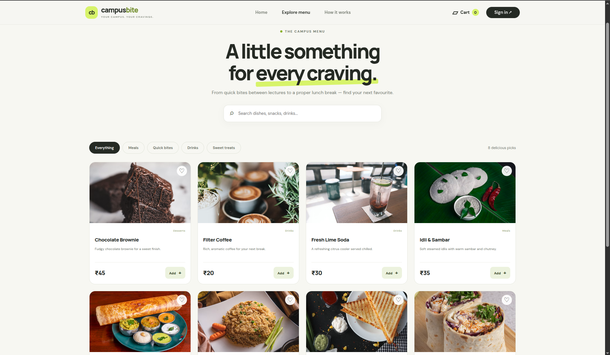

# CampusBite — Campus Canteen Ordering System

## Title and Purpose

**CampusBite** is a campus canteen pre-ordering and management web application built to eliminate rush-hour lunchtime queues and streamline university cafeteria operations. The platform enables students to browse live menu catalogs, manage an active cart, place pre-orders with server-verified authoritative pricing, simulate instant payment, review past orders, and manage account details. For canteen staff, CampusBite provides a session-isolated administrator portal to perform full CRUD operations on menu items and track paid orders across a strict kitchen preparation lifecycle (`PLACED` &rarr; `PREPARING` &rarr; `READY` &rarr; `COMPLETED`).

---

## Tech Stack

- **Language:** Java 21 (LTS)
- **Framework:** Spring Boot 4.1.1 (`spring-boot-starter-webmvc`, `spring-boot-starter-security`, `spring-boot-starter-thymeleaf`, `spring-boot-starter-validation`, `spring-boot-starter-mail`)
- **Data Access:** Spring JDBC (`JdbcTemplate`) with HikariCP connection pooling *(Note: Spring Data JPA starter is present in `pom.xml`, but persistence strictly uses `JdbcTemplate` with direct SQL)*
- **Database:** MySQL 8.0+ via `mysql-connector-j` runtime driver
- **Frontend / Templating:** Thymeleaf 3.x, Bootstrap 5.3.3, Vanilla JavaScript (ES6+), CSS3
- **Security:** Spring Security Crypto (`BCryptPasswordEncoder` for passwords, SHA-256 for stored API and reset tokens), custom session refresh interceptor, and isolated administrator cookie sessions (`ADMINSESSIONID`)
- **Build Tool:** Apache Maven 3.x (with cross-platform `./mvnw` wrapper)

---

## How to Build and Run

### Prerequisites

Ensure the following tools are installed on your workstation:
- **JDK 21** (`java -version` &ge; 21)
- **MySQL Server 8.0+** running on `localhost:3306`
- **Git**

### Step-by-Step Instructions

1. **Clone the repository:**
   ```bash
   git clone https://github.com/JavaBool/CampusQ.git
   cd CampusQ
   ```

2. **Configure environment variables:**
   Set the required database credentials and system settings before building or starting:

   *Linux / macOS (Bash / Zsh):*
   ```bash
   export CANTEEN_DB_USERNAME="canteen_user"
   export CANTEEN_DB_PASSWORD="your-db-password"
   export ADMIN_USERNAME="admin"
   export ADMIN_PASSWORD="your-admin-password"
   export MAIL_USERNAME="your-email@example.com"
   export MAIL_PASSWORD="your-mail-app-password"
   ```

   *Windows (PowerShell):*
   ```powershell
   $env:CANTEEN_DB_USERNAME="canteen_user"
   $env:CANTEEN_DB_PASSWORD="your-db-password"
   $env:ADMIN_USERNAME="admin"
   $env:ADMIN_PASSWORD="your-admin-password"
   $env:MAIL_USERNAME="your-email@example.com"
   $env:MAIL_PASSWORD="your-mail-app-password"
   ```

3. **Navigate to the Spring Boot application directory:**
   ```bash
   cd canteen
   ```
   *(Note: The Maven configuration `pom.xml` and wrapper `./mvnw` reside inside the `canteen/` subfolder).*

4. **Build the application:**
   ```bash
   ./mvnw clean compile
   ```

5. **Start the application:**
   ```bash
   ./mvnw spring-boot:run
   ```

### Application URLs

Once the application starts, access the following local endpoints in your web browser:
- **Student Portal (Home):** `http://localhost:8080/`
- **Menu Catalog:** `http://localhost:8080/menu`
- **Student Sign-In:** `http://localhost:8080/auth/login`
- **Student Registration:** `http://localhost:8080/auth/register`
- **Shopping Cart:** `http://localhost:8080/cart`
- **Student Order History:** `http://localhost:8080/orders`
- **Admin Control Panel:** `http://localhost:8080/admin`
- **Admin Order Queue:** `http://localhost:8080/admin/orders`
- **API Health Check:** `http://localhost:8080/api/v1/`

---

## Database Configuration

### Database Details
- **Database Engine:** MySQL 8.0+
- **Database Name:** `campus_bite`
- **Schema Script Location:** `database/campusbite.sql` (from the repository root)

### Application Database Account Setup
Create the application database user and grant permissions within MySQL:

```sql
CREATE USER IF NOT EXISTS 'canteen_user'@'localhost' IDENTIFIED BY 'your-db-password';
GRANT ALL PRIVILEGES ON campus_bite.* TO 'canteen_user'@'localhost';
FLUSH PRIVILEGES;
```

### Schema Initialization Command
Run the setup script to create the `campus_bite` database and all required tables (`users`, `api_tokens`, `password_reset_tokens`, `items`, `payments`, `orders`, and `order_items`):

```bash
mysql -u canteen_user -p < database/campusbite.sql
```

*(Note: The schema script sets up tables, constraints, and indexes, but does not seed menu items or create administrator accounts automatically. Menu items can be inserted via SQL or managed through the Admin UI at `/admin`).*

### Configuration Properties
The application connects via [`canteen/src/main/resources/application.properties`](canteen/src/main/resources/application.properties) using these variables:

| Environment Variable | Property Key | Default Value | Description |
| :--- | :--- | :--- | :--- |
| `CANTEEN_DB_USERNAME` | `spring.datasource.username` | `canteen_user` | MySQL database user. |
| `CANTEEN_DB_PASSWORD` | `spring.datasource.password` | *(Required)* | MySQL user password. |
| `ADMIN_USERNAME` | `app.admin.username` | `admin` | Login username for `/admin`. |
| `ADMIN_PASSWORD` | `app.admin.password` | *(Configured)* | Login password for `/admin`. |
| `MAIL_USERNAME` | `spring.mail.username` / `app.mail.from` | *(Required)* | SMTP sender email for password resets. |
| `MAIL_PASSWORD` | `spring.mail.password` | *(Required)* | SMTP app password. |
| `APP_BASE_URL` | `app.password-reset.base-url` | `http://localhost:8080` | Base URL embedded in password-reset links. |

---

## Sample Requests

The following executable `curl` commands demonstrate the core APIs implemented in the application.

### 1. API Health & Version Check
Public status endpoint confirming the API service is active.

```bash
curl -i -X GET http://localhost:8080/api/v1/
```
*Expected response:*
```json
{"version":"1.0","status":"working"}
```

### 2. Student Account Registration
Registers a new student account with unique email and college roll number.

```bash
curl -i -X POST http://localhost:8080/api/v1/auth/register \
  -H "Content-Type: application/json" \
  -d '{
    "fullName": "Praveen Kumar",
    "email": "praveen@college.edu",
    "rollNumber": "2025103621",
    "password": "password123",
    "confirmPassword": "password123"
  }'
```
*Expected response (201 Created):*
```json
{
  "message": "Account created successfully. Please sign in.",
  "redirectUrl": "/auth/login?returnUrl=%2F"
}
```

### 3. Student V2 API Login (Stateless Bearer Token)
Authenticates a registered student and returns a 5-day Bearer token.

```bash
curl -i -X POST http://localhost:8080/api/v2/auth/login \
  -H "Content-Type: application/json" \
  -d '{
    "email": "praveen@college.edu",
    "password": "password123"
  }'
```
*Expected response (200 OK):*
```json
{"token":"<RAW_BEARER_TOKEN>"}
```

### 4. Fetch Student Profile via Bearer Token
Uses the Bearer token generated in step 3 to fetch authenticated account details.

```bash
curl -i -X POST http://localhost:8080/api/v2/profile/details \
  -H "Authorization: Bearer <RAW_BEARER_TOKEN>"
```
*Expected response (200 OK):*
```json
{
  "id": 1,
  "fullName": "Praveen Kumar",
  "email": "praveen@college.edu",
  "rollNumber": "2025103621",
  "createdAt": "2026-10-20T10:00:00Z"
}
```

### 5. Administrator Login (Session Cookie)
Authenticates an administrator and saves the secure `ADMINSESSIONID` cookie to `admin-cookie.txt`.

```bash
curl -i -X POST http://localhost:8080/admin/api/login \
  -H "Content-Type: application/json" \
  -c admin-cookie.txt \
  -d '{
    "username": "admin",
    "password": "your-admin-password"
  }'
```
*Expected response (200 OK with `Set-Cookie: ADMINSESSIONID=...`):*
```json
{"message":"Login successful."}
```

### 6. Admin: List All Menu Items
Uses the saved `ADMINSESSIONID` cookie to retrieve all dishes in the menu catalog.

```bash
curl -i -X GET http://localhost:8080/admin/api/items \
  -b admin-cookie.txt
```

### 7. Admin: Create a New Menu Item
Adds a new dish to the menu catalog using the administrator session.

```bash
curl -i -X POST http://localhost:8080/admin/api/items \
  -b admin-cookie.txt \
  -H "Content-Type: application/json" \
  -d '{
    "id": "filter-coffee",
    "name": "Filter Coffee",
    "description": "Rich, aromatic coffee for your next break.",
    "category": "Drinks",
    "price": 20.00,
    "imageLink": "",
    "available": true
  }'
```
*Expected response (201 Created):*
```json
{"message":"Item created successfully."}
```

---

## Screenshots

A visual overview of the implemented user workflows and interfaces across student and administrator views.

### Student Experience & Discovery

| Landing Page | Menu Catalog |
| :---: | :---: |
|  |  |
| *CampusBite landing page with hero banner and value propositions.* | *Interactive menu catalog featuring live search, categories, and pricing.* |

### Student Authentication & Profile

| Registration | Sign-In |
| :---: | :---: |
|  |  |
| *Student registration capturing name, email, roll number, and password.* | *Student sign-in portal with credentials verification.* |

| Student Profile & Settings |
| :---: |
|  |
| *Profile settings allowing inline updates of student details and password changes.* |

### Cart & Checkout Workflow

| Empty Cart | Cart with Items |
| :---: | :---: |
|  |  |
| *Empty cart state prompting menu exploration.* | *Active cart with item thumbnails, quantity controls, and subtotal calculation.* |

| Order Review & Checkout Bill |
| :---: |
|  |
| *Server-generated checkout bill showing order ID and authoritative prices.* |

### Payment Gateway Simulation & Orders

| Payment Gateway Simulation | Payment Confirmation Receipt |
| :---: | :---: |
|  |  |
| *Simulated payment gateway with transaction ID and payable amount.* | *Payment success screen confirming PAID status and receipt details.* |

| Order History ("My Orders") |
| :---: |
|  |
| *Student purchase history showing past orders, timestamps, items, and status tags.* |

### Administrator Management Panel

| Admin Sign-In Portal | Menu Inventory Management |
| :---: | :---: |
|  |  |
| *Isolated administrator authentication portal.* | *Menu management dashboard with inventory counts and CRUD actions.* |

| Admin Order Queue & Status Control |
| :---: |
|  |
| *Kitchen order queue displaying paid orders with lifecycle transition controls.* |
